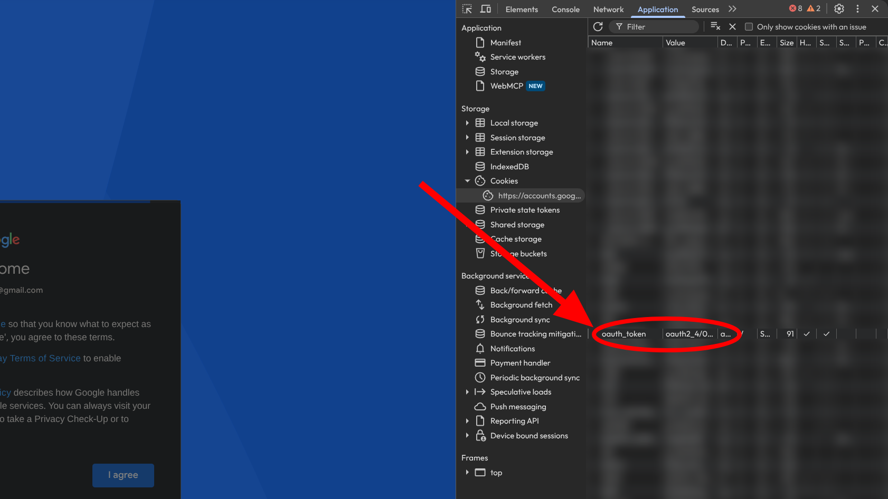

<h1 align="center">
  
</h1>

Sniff is a Cloudflare Worker that returns Google Play app details and download URLs
for the stable, beta, and alpha release channels. The details include the version
code, changelog, and download size.

## API endpoints

The interactive API reference is at `/v3/docs` and the OpenAPI document at
`/v3/openapi.json`.

## Android app

`android-app/` is a companion app for the API. Enter a package ID or a Google Play
link (or share one from Google Play) and choose a channel. To use your own deployment,
tap the settings icon and enter its address.

Apps with split APKs or expansion files can also be saved as an XAPK, which keeps the
original files for split APK installers such as SAI.

- Download: [GitHub Releases](https://github.com/madkarmaa/sniff/releases/latest)
- Requires Android 8.0 (API 26) or newer

## Build from source

Prerequisites:

- [Rust](https://rustup.rs/) stable with the `wasm32-unknown-unknown` target (`rustup target add wasm32-unknown-unknown`)
- [Bun](https://bun.sh/) (used to run Wrangler)
- A Cloudflare account for deploy only (not needed for local dev)

```bash
git clone https://github.com/madkarmaa/sniff
cd sniff
rustup target add wasm32-unknown-unknown
```

### 1. Mint Google Play tokens

Each channel needs a Google account email plus an AAS token. For every account you
plan to use:

1. Sign in at [Google Embedded Setup](https://accounts.google.com/EmbeddedSetup) and
   accept the terms.
2. In developer tools, open Application, then Cookies, then
   `https://accounts.google.com`. Copy the value of the `oauth_token` cookie, which
   starts with `oauth2_4/` and works only once.
3. Exchange it for an AAS token. The helper prints the token:

    ```bash
    cargo run -p oauth2aas -- <email> <oauth_token>
    ```



### 2. Local dev

Create `.dev.vars`:

```
DEVICE_NAME="px_9a"
STABLE_EMAIL="..."
STABLE_AAS_TOKEN="..."
BETA_EMAIL="..."
BETA_AAS_TOKEN="..."
ALPHA_EMAIL="..."
ALPHA_AAS_TOKEN="..."
```

`STABLE_*` is required; the beta and alpha pairs are only needed for those channels.
Then:

```bash
bun install
bun run dev
curl -fsSL -A "Mozilla/5.0" http://localhost:8787/v3/download/com.discord/stable
```

`wrangler dev` simulates the KV namespace and the rate limiter and keeps KV data in
`.wrangler/state`. The first lookups check devices in on the real accounts; later
runs reuse them from that state.

### 3. Checks

```bash
cargo check --all
cargo fmt --all -- --check
cargo clippy --all --locked -- -D warnings
cargo clippy -p sniff --target wasm32-unknown-unknown --locked -- -D warnings
cargo test --workspace --locked
```

### 4. Android app

Prerequisites:

- JDK 17 or newer
- The Android SDK with the API 37 platform. Set `ANDROID_HOME`, or `sdk.dir` in
  `android-app/local.properties`, to its location

```bash
cd android-app
./gradlew :app:assembleDebug
adb install app/build/outputs/apk/debug/app-debug.apk
```

## Environment variables

`DEVICE_NAME` and the `STABLE_*` pair are required. The `BETA_*` and `ALPHA_*` pairs
are only needed to serve those channels.

- `DEVICE_NAME`: Device identifier for metadata requests (default `px_9a` in `wrangler.toml`); download targets remain independent
- `STABLE_EMAIL`: Email for stable track access
- `STABLE_AAS_TOKEN`: Authentication token for stable track
- `BETA_EMAIL`: Email enrolled in beta programs
- `BETA_AAS_TOKEN`: Authentication token for beta access
- `ALPHA_EMAIL`: Email enrolled in alpha programs
- `ALPHA_AAS_TOKEN`: Authentication token for alpha access

`wrangler.toml` also declares two bindings:

- `SESSIONS`: KV namespace for Google sessions and registered devices
- `LOOKUP_LIMITER`: Rate limit for uncached lookups per client (10 per 60 seconds)
